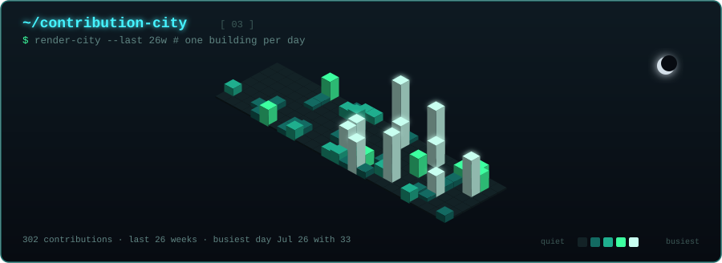

<!-- Profile source: tools/curated.js + tools/render.js. Generated graphics complement the written content below. -->

# Preetam Gaikwad · `kookoocoder`

**Think. Create. Solve.**

I build full-stack products, privacy-first tools, and machine-learning pipelines with Team Knull. From keeping sensitive prompts on-device to making long application forms resumable, I like software that solves a real problem—not just a demo that looks the part.

[LinkedIn](https://www.linkedin.com/in/preetam-gaikwad-64a1b135b/) · [Instagram](https://www.instagram.com/build.preetam/) · [Explore my repositories](https://github.com/kookoocoder?tab=repositories)

## `~/about`

- **5× hackathon winner** · Project Manager & Team Lead · Team Knull.
- Pursuing **BTech CSE at MIT**, alongside studies at **IIT Madras**.
- **CSI Executive Member** · Chhatrapati Sambhajinagar, Maharashtra, India.

I work across product and implementation: understanding the problem, coordinating the build, and connecting the interface to the data and logic behind it. My projects explore privacy, industrial safety, civic-tech, and market research.

## `~/activity`

The skyline is built from my real contribution calendar. **One address per day; taller buildings mean more contributions.** The dashboard refreshes daily through GitHub Actions—no external stats-card service.

## `~/selected-builds`

### [Prompt Filter ↗](https://github.com/kookoocoder/prompt_filter)

`LOCAL-FIRST PRIVACY`

Clean sensitive information from a prompt before it leaves your machine. A local-first sanitizer built around privacy at the point of input.

**Built with:** Python · FastAPI · TypeScript.

### [Visual Guard ↗](https://github.com/kookoocoder/visual-guard)

`ON-DEVICE REDACTION`

A browser-extension privacy layer for on-device text and image redaction. Brings document and vision tooling closer to the user, rather than sending everything away.

**Built with:** JavaScript · Transformers.js · Tesseract.js.

### [Paisa AI Model ↗](https://github.com/kookoocoder/paisa_ai_model)

`APPLIED MACHINE LEARNING`

A checkpointed training pipeline: OHLCV data → feature engineering → Optuna search → XGBoost / LightGBM → ARIMA → evaluation → packaged artifacts. Runs on Modal; training-only, not an inference API.

**Built with:** Python · Modal · Optuna · XGBoost · LightGBM.

### [SafetyIQ ↗](https://github.com/kookoocoder/safetyiq)

`INDUSTRIAL SAFETY`

Compound risk detection for industrial environments. Connects a TypeScript application with local AI and inference tooling to explore combined risks, not just isolated signals.

**Built with:** Next.js · TypeScript · ONNX Runtime · LM Studio.

### [Sahaj Visa ↗](https://github.com/kookoocoder/sahaj-visa)

`CIVIC-TECH PROTOTYPE`

An independent e-Tourist Visa prototype with autosave, resumable forms, deterministic checks, an audit log, and a status timeline. Payments and government integrations are mocked; no real visa is issued.

**Built with:** TypeScript · Next.js.

### [Paisa ↗](https://github.com/kookoocoder/paisa)

`PAPER-TRADING RESEARCH`

An India-focused intraday paper-trading research harness with an autonomous replay dashboard. Research and simulation—not a claim of profitable live trading.

**Built with:** Python · pandas · scikit-learn.

## `~/toolkit`

Tools represented in my public projects—not a claim of equal expertise in every dependency.

| Area | Technologies |
| :--- | :--- |
| **Languages** | TypeScript, JavaScript, Python, SQL, Clarity |
| **Web & interfaces** | React, Next.js, Tailwind CSS, Vite, shadcn/ui, Framer Motion |
| **APIs & data** | FastAPI, Pydantic, PostgreSQL, Prisma, Supabase, Convex, Redis |
| **ML & research** | pandas, NumPy, scikit-learn, XGBoost, LightGBM, ARIMA, Optuna, Modal |
| **AI & privacy** | MCP, Vercel AI SDK, ONNX Runtime, Transformers.js, Tesseract.js |
| **Blockchain** | Clarity / Stacks, Clarinet SDK |
| **Testing & delivery** | pytest, Vitest, Node.js test runner, Git, GitHub Actions |

**Stack evidence:** [web](https://github.com/kookoocoder/WebSynx/blob/main/package.json) · [APIs](https://github.com/kookoocoder/prompt_filter/blob/main/pyproject.toml) · [ML training](https://github.com/kookoocoder/paisa_ai_model/blob/main/pyproject.toml) · [vision](https://github.com/kookoocoder/visual-guard/blob/main/package.json) · [Stacks](https://github.com/kookoocoder/stack-web3/blob/main/package.json).

## `~/engineering-notes`

- **Privacy before transmission.** Clean sensitive inputs and process locally when the problem allows it.
- **Recovery is a feature.** Resumable forms and checkpointed training runs solve different versions of the same problem: lost progress.
- **Keep the claims honest.** Paper trading is research. A prototype is a prototype. The useful part should speak for itself.
- **Build beyond the happy path.** State transitions, validation, and failure handling belong to the product, not the backlog.

## `~/more-experiments`

- [**A.R.T.I.S**](https://github.com/kookoocoder/A.R.T.I.S) — Automated Response Technology for Information and Solutions.
- [**Auto Review Bot**](https://github.com/kookoocoder/auto-review-bot) — static QR codes with rotating review-text pools.
- [**Data Cleaning Demo**](https://github.com/kookoocoder/dwv-data-cleaning-demo) — cleaning messy CSV data in Python or Google Colab.
- [**Stack Web3**](https://github.com/kookoocoder/stack-web3) — smart-contract development with Clarity on Stacks.

## `~/connect`

Building something in **privacy, applied AI, full-stack development, or blockchain**? Let's talk on [LinkedIn](https://www.linkedin.com/in/preetam-gaikwad-64a1b135b/). Follow the work on [Instagram](https://www.instagram.com/build.preetam/).

How this profile is coded

The README contains real, selectable text. The terminal header, telemetry, and city are custom SVGs generated with dependency-free Node.js—not screenshots or third-party badge widgets. GitHub READMEs don't run custom CSS or JavaScript, so SVG handles the visual effects while Markdown handles the content and links.

- `tools/curated.js` — personal copy, projects, and verified toolkit.
- `tools/fetch-data.js` — paginated public repository data and the contribution calendar.
- `tools/render.js` + `tools/style.js` — README and terminal artwork.
- `tools/city.js` — deterministic isometric geometry, windows, and lighting.
- `node --test tools/*.test.js` — generator regression tests.

Language mix excludes `paisa` (bundled StockSharp sources), `chess-game-` (upstream Session Android code), and this profile's generated graphics. Repository presence or byte count alone doesn't establish authorship or proficiency.

Visual direction inspired by [Giorgi Kobaidze's terminal profile](https://github.com/georgekobaidze). This implementation and all profile copy are personalized for kookoocoder.

